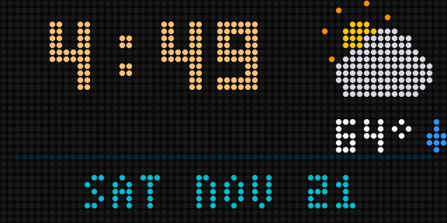
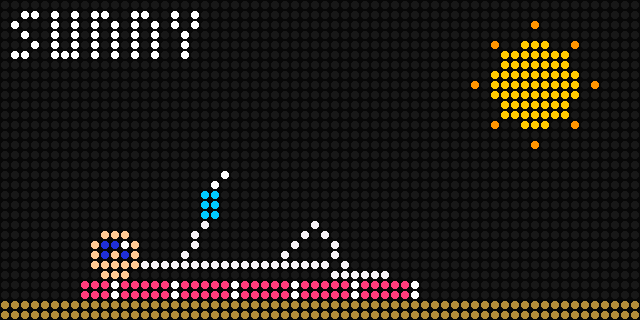
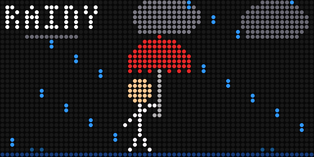
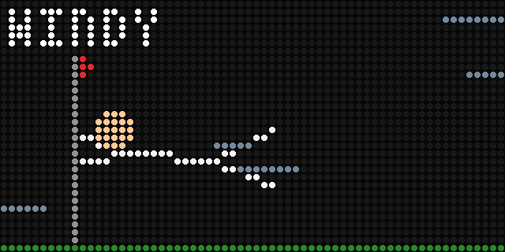
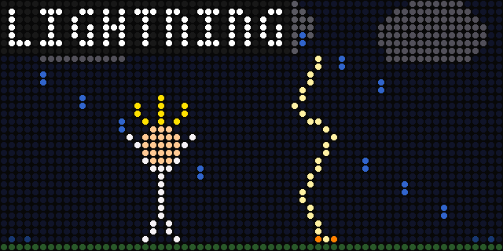
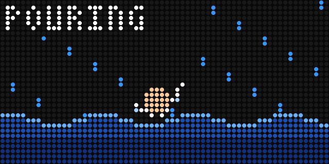

# LED Frame

A framed 64×32 RGB LED wall display driven by an ESP32. It shows the time, live weather acted out by a
little stick figure, messages, countdowns and ambient art, and it's controlled from Home Assistant or
a phone page on the local network.

## What it does

| Screen | What you see |
|---|---|
| **Clock** | Big time, weather icon, temperature, date / today's high and low, a blinking raindrop when rain is coming |
| **Weather** | A stick figure living the weather: sunbathing in shades, under an umbrella, swimming in a downpour, clinging to a pole in the wind, throwing snowballs, hair on end in a thunderstorm… |
| **Message** | Scrolling text sent from a phone or a Home Assistant automation |
| **Countdown** | Days until an event, with a little plane flying overhead |
| **Art** | Slow colour waves with a quiet clock |
| **Alerts** | Pop-up messages from Home Assistant (e.g. rain warnings) that interrupt, then return |

**Auto** mode rotates through the screens; each screen can also be pinned.

<p>
  
  
  
  
  
  
</p>

Captured from the running frame with `tools/snapshot.py`. More on the
[project page](https://asbatty.github.io/portfolio/led-frame/).

## Hardware

- Waveshare 64×32 P4 HUB75 RGB matrix panel
- ESP32-WROOM-32E DevKitC
- 5 V 5 A power supply feeding both the panel and the ESP32 (5V pin), shared ground
- 16-wire HUB75 ribbon to the ESP32 (pin map in [`firmware/LedFrame/config.h`](firmware/LedFrame/config.h))

## How it works

```
Home Assistant ──MQTT──► Mosquitto broker ──► ESP32 firmware ──► HUB75 panel
                                                  ▲
                         phone browser ──HTTP─────┘  (http://matrix.local)
```

- **Firmware** (`firmware/LedFrame`, Arduino/C++): draws every frame into an off-screen canvas, then
  pushes it to the panel in one go via the
  [ESP32-HUB75-MatrixPanel-DMA](https://github.com/mrcodetastic/ESP32-HUB75-MatrixPanel-DMA) library.
  A custom 3×5 pixel font and hand-built pixel-art scenes keep everything legible at 64×32.
- **Home Assistant** integration uses MQTT device discovery: one retained message creates a light
  (on/off + brightness), mode and colour selects, message and countdown text fields, a notify entity for
  alerts, a restart button and diagnostics. Home Assistant pushes weather to `ledframe/weather`.
- **Wi-Fi setup** happens through a temporary hotspot (WiFiManager); no Wi-Fi password lives in the code.
- **Updates** install over Wi-Fi.

## Build and install

Requirements: Arduino IDE 2 (or `arduino-cli`) with the **esp32** board package and these libraries:
ESP32 HUB75 LED MATRIX PANEL DMA Display, Adafruit GFX, PubSubClient, ArduinoJson 7, WiFiManager.

1. Copy `firmware/LedFrame/secrets.example.h` to `secrets.h` and fill in the MQTT broker and an update password.
2. First install over USB (board **ESP32 Dev Module**, partition scheme **Minimal SPIFFS**):
   ```powershell
   powershell -ExecutionPolicy Bypass -File tools\flash.ps1 -Usb COM5
   ```
3. Join the **LED-Frame-Setup** Wi-Fi from a phone and pick your network (if the page doesn't pop up,
   open `http://192.168.4.1` in Samsung Internet/Safari with mobile data off).
4. After that, every update goes over Wi-Fi:
   ```powershell
   powershell -ExecutionPolicy Bypass -File tools\flash.ps1
   ```

## Controlling it

- **Phone:** `http://matrix.local`: power, brightness, screen, message and colour, countdown, test alerts.
- **Home Assistant:** the *LED Frame* device. Example automation action:
  ```yaml
  action: notify.send_message
  target: { entity_id: notify.led_frame_alert }
  data:
    message: '{"text":"RAIN IN 30 MIN","icon":"rain","color":"#3399ff","duration":20}'
  ```
- **Weather data** (published by Home Assistant, retained) on `ledframe/weather`:
  `{"cond":"rainy","temp":61,"hi":66,"lo":52,"rain_soon":true,"rain_in":30}`; `cond` uses Home
  Assistant's weather states (`sunny`, `rainy`, `windy`, …).

## Tuning and debugging (local network)

| URL | Does |
|---|---|
| `/api/tune?wxdemo=1` / `=windy` / `=0` | Cycle all weather scenes / hold one / stop |
| `/api/tune?flip=0\|1` | Rotate the picture 180° (saved) |
| `/api/tune?clkphase=0\|1&depth=8&refresh=90` | Panel timing (saved, restarts) |
| `/api/frame` | Text dump of the frame being drawn; `python tools/snapshot.py` turns it into a PNG |

## Lessons from the build

- **Ghosting fixed by clock phase, not blanking:** with most of the panel lit, black pixels next to
  bright text glowed faintly. Latch blanking and colour depth made no difference; this panel latches
  data on the other clock edge (`clkphase = false`).
- **Black is invisible on LEDs:** sunglasses drawn in black just looked like a hole in the head.
  Detail on dark backgrounds needs lit colours.
- **Very dim colours flicker:** channels below ~48/255 at low brightness shimmer, so the art palette
  snaps each channel to off or a safe minimum.
- **GPIO 12 is a strapping pin:** the panel's G2 line on it can stop the ESP32 from booting; G2 moved to GPIO 33.
